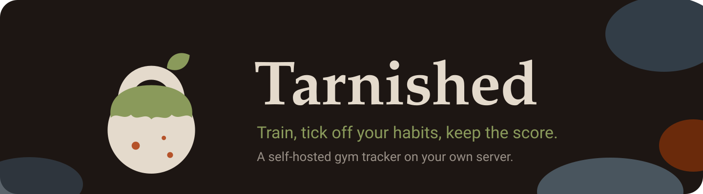
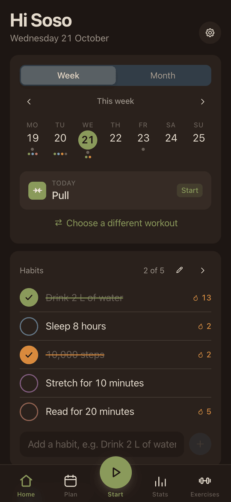
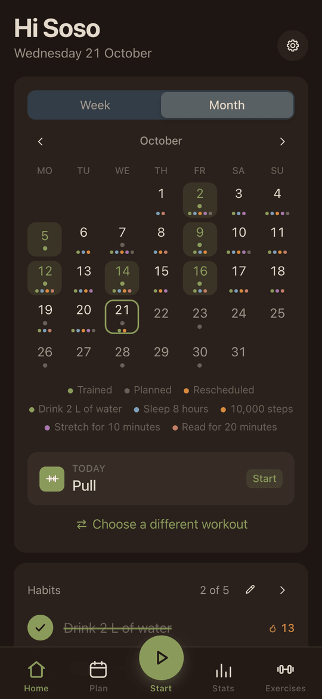
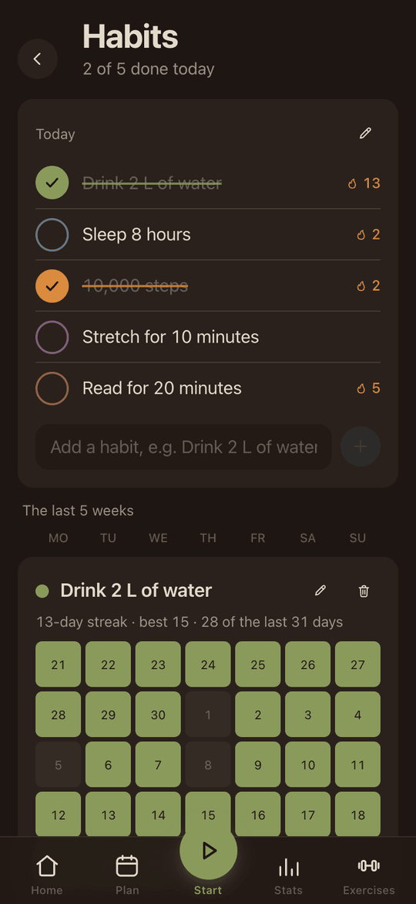
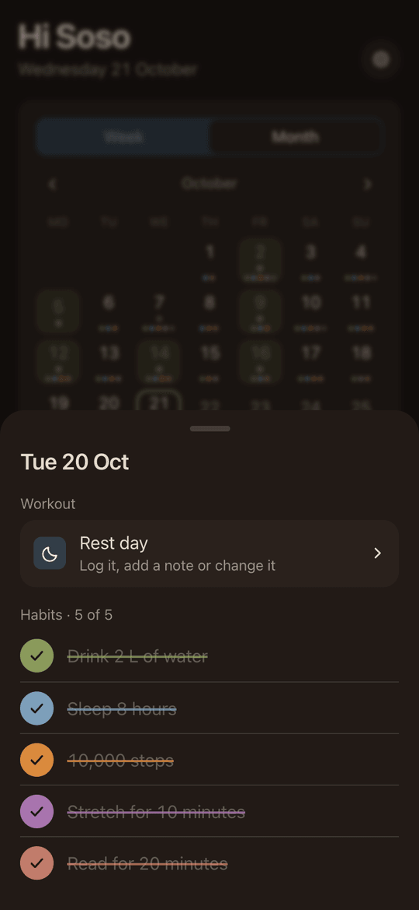
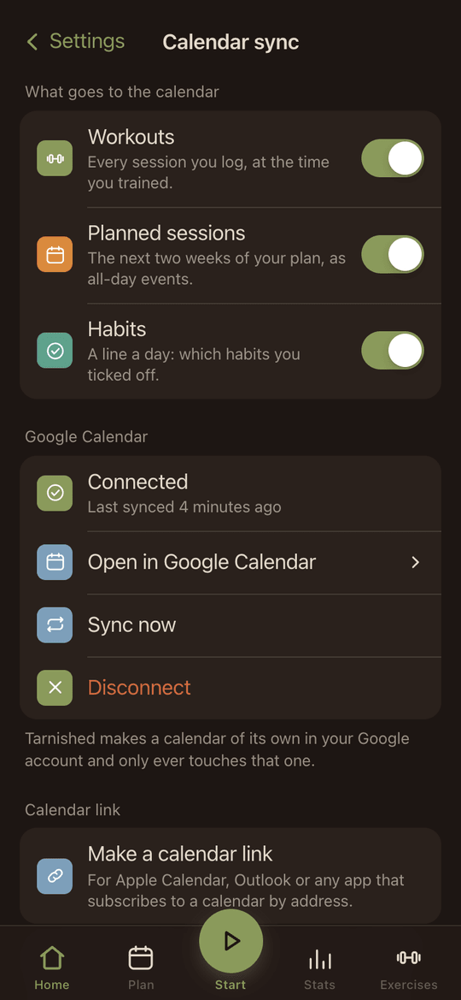
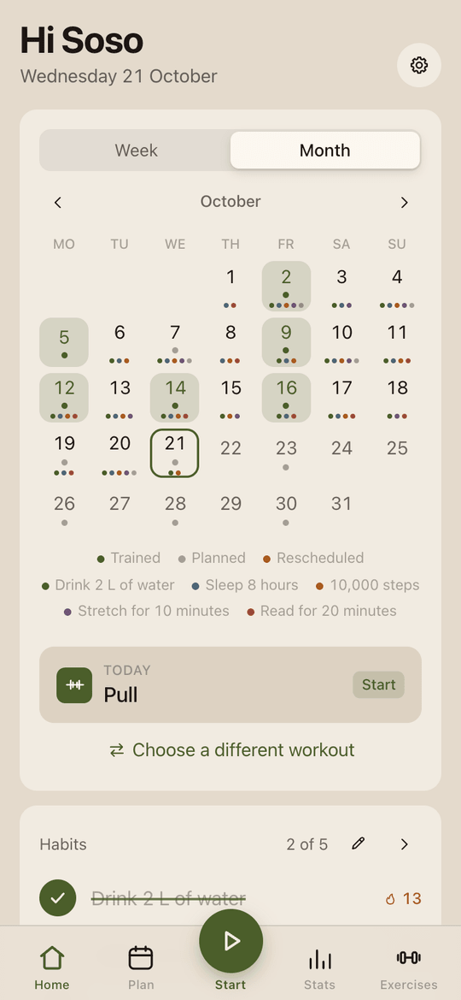

<div align="center">



**A self-hosted gym tracker with daily habits and a calendar that keeps the score.**

Plan your week, run guided workouts, log every set and your body weight, tick off your habits,
and see it all on one calendar, synced to Google Calendar if you like. On your own server.

[Self-hosting](docs/SELF_HOSTING.md) ·
[Calendar sync](docs/GOOGLE_CALENDAR.md) ·
[Phone app](docs/MOBILE.md) ·
[Docs](docs/README.md)

</div>

<table align="center">
<tr>
<td align="center"><br><sub><b>Home</b> · the week, today's session, habits</sub></td>
<td align="center"><br><sub><b>Calendar</b> · workouts and habits by day</sub></td>
<td align="center"><br><sub><b>Habits</b> · streaks and history</sub></td>
</tr>
<tr>
<td align="center"><br><sub><b>A day</b> · what happened, at a glance</sub></td>
<td align="center"><br><sub><b>Calendar sync</b> · Google or any app</sub></td>
<td align="center"><br><sub><b>Light mode</b> · same stones on parchment</sub></td>
</tr>
</table>

## What it does

**Train**

- A routine per weekday, or a rotation (A, B, C, A …) over a library of more than 5,600 exercises,
  searchable and browsable by muscle on a body map.
- Guided sessions: weights pre-filled from last time, a rest timer between sets, PRs as they
  happen. Supersets, warm-ups, drop sets, rest-pause, timed and cardio exercises, plate math.
- Progression rules per routine or exercise (linear, Greyskull, double and triple progression,
  time), with stalls that trigger a deload. Estimated 1RM, structural-balance ratios, a muscle map
  of volume and recovery, body weight against a goal.

**Habits**

- Water, sleep, steps, stretching, reading: anything you want to tick off once a day. Add one in
  the field on Home, tick it, and it's struck through.
- Streaks per habit, five weeks of history on the Habits screen, and past days can be ticked from
  the calendar.

**Calendar**

- Home's calendar switches between the week and the whole month. Every day shows what you trained,
  what's planned, and a coloured dot for each habit done.
- Tap a day for everything on it: the workout, the plan, the weigh-in, each habit.
- **Sync** to Google Calendar (a calendar of its own, nothing else touched) or to any calendar app
  through a private subscription link. See [docs/GOOGLE_CALENDAR.md](docs/GOOGLE_CALENDAR.md).

**Your data**

- Passkey sign-in, profiles for the people you host it for, and two devices editing at once merge
  entry by entry instead of overwriting each other.
- Import from FitNotes, Strong, Hevy and Apple Health; export everything as one JSON file.
- Optional extras, off by default: an [AI coach](docs/AI_COACH.md) on your own provider key, and an
  [MCP server](mcp/README.md) so an assistant can read your training history.

## Quick start

You need [Docker](https://docs.docker.com/get-docker/) with Compose.

```bash
git clone https://github.com/Sosoisworking/openGym tarnished
cd tarnished
cp .env.example .env
docker compose up -d --build
```

Open <http://localhost:8080>, tap **Create new profile**, and you're in. There are no prebuilt
images: Compose builds both containers from this checkout, so you don't need Node on the host.

To reach it from your phone with passkeys you need HTTPS on a domain, a two-line change in `.env`.
The [self-hosting guide](docs/SELF_HOSTING.md) walks through Cloudflare Tunnel, Caddy, Traefik and
nginx, and [HTTPS on a LAN](docs/SELF_HOSTING_HTTPS.md) covers a home network.

<details>
<summary><b>Configuration reference</b> (all through <code>.env</code>)</summary>

| Variable | What it does | Default |
|---|---|---|
| `RP_ID` | Hostname passkeys are bound to | `localhost` |
| `ORIGIN` | Full URL the app is served from | `http://localhost:8080` |
| `WEB_PORT` | Host port for the web UI | `8080` |
| `NGINX_PORT` | Port the web container listens on inside the container | `80` |
| `BACKEND` | Name of the API service that `/api` is proxied to | `api` |
| `PORT` | Port the API listens on; the web container proxies to the same value | `3000` |
| `RP_NAME` | Name shown in the passkey prompt | `Tarnished` |
| `SESSION_DAYS` | How long a sign-in lasts, in days | `90` |
| `GOOGLE_CLIENT_ID`, `GOOGLE_CLIENT_SECRET` | Your Google OAuth client, for Google Calendar sync ([guide](docs/GOOGLE_CALENDAR.md)) | *(off)* |
| `GOOGLE_REDIRECT_URI` | Only if Google must call back somewhere other than `ORIGIN` | `ORIGIN/api/google/callback` |
| `ADMIN_UIDS` | User ids that get the admin dashboard, comma-separated | *(none)* |
| `FIRST_USER_ADMIN` | `1`: the first profile created on an empty instance becomes its admin | *(off)* |
| `INVITE_ONLY` | Require an invite code to create a profile | *(off)* |
| `ALLOW_GUEST` | Offer "Continue without account"; `0` requires a profile | *(on)* |
| `PASSWORD_LOGIN` | Offer name-and-password sign-in next to passkeys | *(off)* |
| `TRUST_PROXY` | Let the sign-in throttle read the client address from proxy headers | `1` in `docker-compose.yml` |
| `AUDIT_LOG` | Record sign-ins and admin actions; `0` records nothing | *(on)* |
| `AUDIT_MAX` | Events kept in the activity log; `0` for no limit | `5000` |
| `AUDIT_DAYS` | Days kept in the activity log; `0` keeps until `AUDIT_MAX` | `90` |
| `AUDIT_IP` | Record the caller's address: `off`, `net` (network only) or `full` | `off` |
| `ALLOWED_PRIVATE_IPS` | Private addresses push endpoints may resolve to: comma-separated IPs, `a-b` ranges or CIDR blocks | *(none)* |
| `VAPID_SUBJECT` | Contact URL sent with push notifications | your `ORIGIN` |
| `API_TARGET` | API image to build: `default`, or `coach` with the Claude Agent SDK and Codex CLI | `default` |
| `COACH_DISABLED` | `1` forces the AI coach off instance-wide | *(unset)* |

Push-notification keys are generated on first run into `./data/vapid.json`. `DATA_DIR` is pinned to
`/data` inside the container and mapped to `./data` on the host; change the volume, not the
variable.

</details>

## How it's built

- **`frontend/`**: React 19 and Vite (React Router, Zustand), built to static files. The look is
  one set of colour tokens at the top of `src/index.css`, dark first, with a light theme beside it.
- **`api/`**: plain `node:http`, no framework. Profiles and data are JSON files under `./data`.
  Passkeys through `@simplewebauthn/server`, notifications through `web-push`, and the calendar
  export (iCalendar and Google Calendar) in plain `fetch`.
- **`web/`**: builds the frontend and serves it with nginx, proxying `/api` so the app sits on one
  origin, which passkeys require.

Training and habit logic (progression, 1RM, streaks, how a session is read back) lives in pure
functions under `frontend/src/lib/` with tests beside them: about 4,800 frontend tests and 600 API
tests. The HTTP API is documented as an OpenAPI spec in [`api/openapi.yaml`](api/openapi.yaml).

Sync keeps one document per profile with a server revision. A device that saves over a revision it
didn't see gets the current document back, merges, and saves again. Every change carries its own
stamp, down to a single habit tick on a single day, so the newest edit of each wins and a deletion
stays deleted.

Everything lives in `./data`: `db.json` (profiles and public passkey data), `state-<user>.json`
(each profile's plan, workouts, habits and settings), `google/` (calendar connections), `secret`
(the session key). Back up `./data` and you've backed up everything.

Tarnished is developed with [Claude Code](https://claude.com/claude-code); the repository carries
a [`CLAUDE.md`](CLAUDE.md) with the project context those sessions start from.

## Phone app

The same codebase builds a standalone Android and iPhone app with Capacitor: no account needed,
everything on the phone, or paired with your server. There's no store listing or published APK
yet; [docs/MOBILE.md](docs/MOBILE.md) has the build steps.

## Credits and licence

Tarnished is a fork of **[openGym](https://github.com/DuarteSantos8/openGym)** by Duarte Santos,
which built the training app this one grew from. Like openGym it is licensed under the
[GNU AGPL v3.0](LICENSE): you can self-host, use, modify and share it, and if you run a modified
version as a network service, you offer its source under the same licence.

> [!IMPORTANT]
> **The exercise media is not covered by that licence.** The stills and animations are
> © Aliaksandr Makatserchyk, [Gym visual](https://gymvisual.com/), licensed for use in openGym, and
> kept here unmodified as a non-commercial fork may. Anything else, a commercial use included, needs
> your own licence from gymvisual.com, and the media may not be used to train or feed an AI system.

Full third-party notices, the body-diagram geometry and the exercise text included, are in
[NOTICE.md](NOTICE.md).
